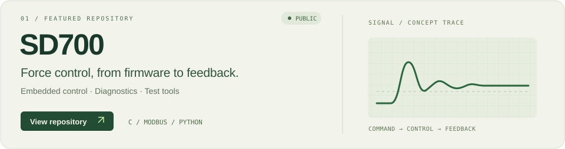
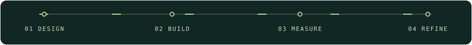

<a href="https://github.com/Jeffaaay/SD700">
  <picture>
    <source media="(max-width: 600px)" srcset="./assets/header-mobile.svg" />
    
  </picture>
</a>

I work on the software that connects commands, sensors, and physical motion.

### Featured project

<a href="https://github.com/Jeffaaay/SD700">
  <picture>
    <source media="(max-width: 600px)" srcset="./assets/sd700-mobile.svg" />
    
  </picture>
</a>

**[SD700](https://github.com/Jeffaaay/SD700)** brings together embedded force-control firmware, communication interfaces, diagnostic tools, and test documentation.

- **Firmware** — C control logic and motor interfaces.
- **Communication** — Modbus, RS485, and sensor feedback.
- **Verification** — Python / PowerShell tools, logs, and test records.

The project is under active development. Software checks and physical validation are tracked separately; see the [current README](https://github.com/Jeffaaay/SD700#readme) for the latest status.

**[Explore the code ↗](https://github.com/Jeffaaay/SD700)** &nbsp; · &nbsp; **[Project documentation ↗](https://github.com/Jeffaaay/SD700/tree/main/Docs)**

 

<!-- Original SVG artwork. Motion and layout references explored during design:
https://github.com/DenverCoder1/DenverCoder1
https://github.com/Platane/Platane
Animations are decorative, not live telemetry or test results.
-->
